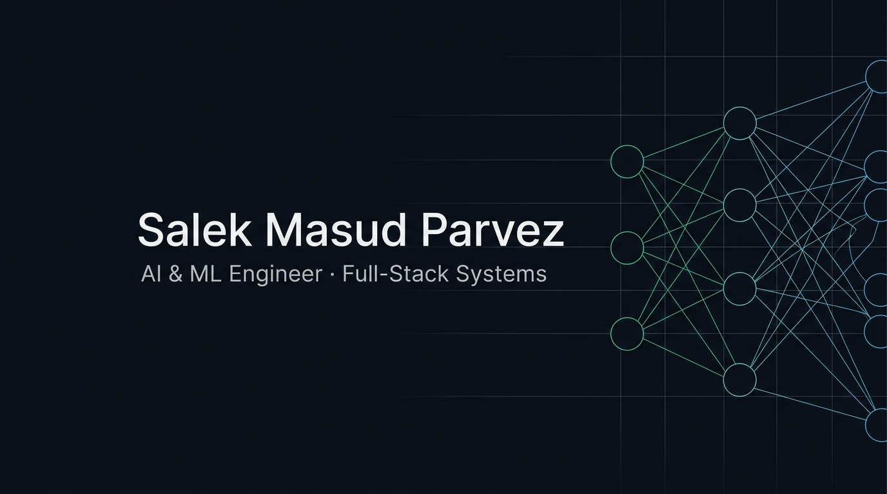
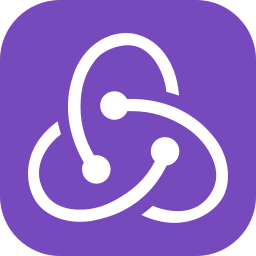
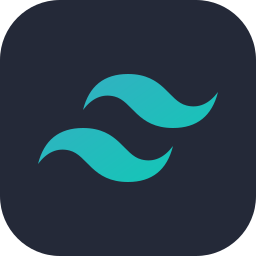
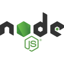

  

<h1 align="center">Salek Masud Parvez</h1>

  <strong>AI &amp; ML Engineer · Full-Stack TypeScript &amp; Python Developer</strong>

  <a href="https://www.linkedin.com/in/salek-masud-parvez/">LinkedIn</a>
  &nbsp;·&nbsp;
  <a href="https://github.com/salekmasudparvez1">GitHub</a>
  &nbsp;·&nbsp;
  <a href="mailto:salekmasudparvez@gmail.com">Email</a>

---

## About Me

I am **Parvez**, an **AI & Full-Stack Engineer** focused on building production web platforms, LLM-powered workflows, and data-driven applications. My work spans modern frontend architecture (**Next.js, React, TypeScript, Redux, Tailwind CSS**), scalable backend services (**Node.js, Express, PostgreSQL, MongoDB, Firebase**), and applied machine learning (**Python, Jupyter, Scikit-Learn, RAG & AI Agents**).

---

## GitHub Telemetry

  

---

## Core Technologies

  &nbsp;&nbsp;
  &nbsp;&nbsp;
  &nbsp;&nbsp;
  &nbsp;&nbsp;
  &nbsp;&nbsp;
  &nbsp;&nbsp;
  &nbsp;&nbsp;
  &nbsp;&nbsp;
  &nbsp;&nbsp;
  &nbsp;&nbsp;
  &nbsp;&nbsp;
  

| Domain | Stack |
| :--- | :--- |
| **AI & Data** | Python, Jupyter Notebook, Scikit-Learn, LLM APIs, RAG Pipelines, Prompt Engineering |
| **Frontend** | TypeScript, React, Next.js, Astro, Redux, Tailwind CSS, HTML5, CSS3 |
| **Backend & APIs** | Node.js, Express.js, REST APIs, Serverless Functions |
| **Databases & Infra** | PostgreSQL, MongoDB, Mongoose, Firebase, Docker, Vercel |

---

## Current Focus

- **Engineering**: Designing AI-assisted full-stack applications with strong type safety and low-latency APIs.
- **Exploring**: Advanced PostgreSQL indexing/pgvector workflows, LLM evaluation, and agentic systems.
- **Open to**: Collaborating on open-source AI tools, developer utilities, and full-stack products.
